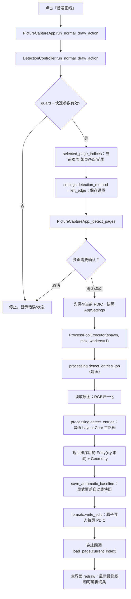
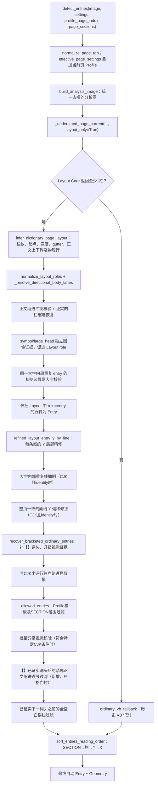

# 【普通画线】点击后至最终 PDIC 的实际执行链（代码审计，2026-10-12）

> 本文针对 PR #459 的 `left_edge` **普通画线按钮**路径，不把「OCR画线」「融合画线」或【Layout】诊断按钮当作同一路径。函数与条件逐项源自仓库代码。流程中的 `debug_trace` 为新增的**仅用于诊断的可选参数**，普通用户画线时不传。

## 总流程：GUI → spawn worker → PDIC

**重要：**`left_edge` 是界面/配置中的模式名称，但**正常情况下并非直接运行传统 VB.NET 左边缘扫描**。只要 Layout Core 推断出了非空栏集合，走的就是 Layout 物理行/角色主路径。传统 VB 路径仅在 Layout 结果不可用或栏为空时触发备用分支。

## 识别内核详细流程

### 1. 参数、页面范围、并行边界

- `app.py` 里的普通画线按钮委托给 `ui/controllers/detection.py::DetectionController.run_normal_draw_action`。
- 参数验证：`guard` 和 `_apply_quick_settings_for_ordinary`。后者允许 **OCR引擎全部关闭**时进行普通画线，且会恢复界面原有的 OCR 勾选状态；不意味着临时勾选的 OCR 被用于识别。
- 页面范围：`selected_page_indices`。多页画线显示明确的 **PDIC 覆写确认**；点击批量画线前调用 `save_pdic(silent=True)` 保存当前页已有修改。
- 使用 `multiprocessing.get_context("spawn")` 的 `ProcessPoolExecutor(max_workers=1)`；每页在子进程里执行 `processing.detect_entries_job`，不是直接在 Tk 主线程计算。
- `settings.detection_method="left_edge"`；这一路没有 Paddle OCR 词头识别、没有语义 OCR 文本填充。

### 2. Project/Profile 与分析图

- `processing.detect_entries` 对原图 RGB 归一化，按当前页 `profile_page_index` 生成 `effective_page_settings`，并调用 `build_analysis_image`。
- `_understand_page_current(...,layout_only=True)` 可按 `layout_mask_illustrations` 屏蔽插图，然后调用 `layout_core_understanding.understand_layout_core`。
- `dictionary_page_layout_policy.resolve_page_layout_policy`：如果 `ordinary_auto_layout` 关闭，主要沿用固定 Project 参数；开启时仅将被勾选的字段替换为实测/登记值。其中特殊的 `manual_x` 使用语义栏原点配准，`row_padding` 不能让没有实测证据的恒定1px占位值覆盖已有设置。
- `infer_dictionary_page_layout` 根据栏位/正文高度和图像投影形成 `layout.columns`、`LayoutLine`、缩进簇及 `body_top/body_bottom`。

### 3. Layout role 与独立大字/符号证据

- 先 `normalize_layout_roles`，然后 `_resolve_directional_body_lanes`。如果 `indent_type=body`，更靠内侧的稳定缩进簇视为正文簇；如果 `headword`，方向相反；`none` 不靠缩进决定词头。
- `suppress_contradictory_cjk_body_lane_entries` 对已发现的群体异常进行有限的视觉核验；`restore_proven_column_indents` 在符合独立图像证据的缺损栏恢复候选。
- `detect_ordinary_symbol_entries` 与 `detect_ordinary_large_head_entries` 产生视觉证据。`promote_evidence_to_layout_roles` 对通过验证的大字词头执行大字顶部 `entry`、内部续行 `body`；`_suppress_display_head_duplicate_entries` / `_suppress_large_evidence_duplicate_entries` 去重。
- `recover_verified_oversized_heads` 只对先前明确确认角色冲突的栏做额外字形核验。**普通 Layout 的 role 不等于最终 PDIC：**这之后还有 Y 精修、补词头和多重过滤。

### 4. Entry 实体化与 Y 精修

- `_ordinary_entries_from_layout_roles` 只遍历 `role == "entry"` 的物理行；每条建立 `Entry(word="",x=栏源图起点,y=精修后的源图Y)`，并从 LayoutLine 复制视觉来源和大字属性。
- `separator_y_refinement.refined_layout_entry_y_by_line` 调用共享 Y 微调，限制相对原始物理行的位移不能超过约 `0.45×正文行高`。Y 变化不是新增/删除词条。
- 对横排未变换的 CJK 页面，随后执行 `suppress_oversized_head_fragment_entries` 与 `adjust_page_coherent_crossing_separators`。
- `recover_bracketed_ordinary_entries` 从同页已验证的【】字形推断完整或粘连括号词头，可能新增候选，也可能把已有候选的来源升级为 `ordinary_bracket_pair`，以免被后续过滤误删。

### 5. 最后的保守过滤（最容易出现「Layout对但实际画线不对」）

- `_allowed_entries`：必须在当前 Profile 的模板内，且在有效 SECTION 范围内。
- `correct_anomalous_final_ordinary_entries`：特定两栏、CJK、正文缩进、identity 条件下，原来要求同栏有**至少6条**或一定比例的异常才进行批量修正，因此它不会自动处理两条孤立误检。
- **新增** `suppress_proven_bracket_body_continuations`：只在前一个相邻候选已由【】词头确认、距离约一个正文行高、当前为未证实的普通 Layout 候选、且真实像素起始位置明显落在重复正文缩进带内时删除。第9页 Y=204、807 的静态图像证据符合这一逻辑；**禁止使用固定页号/Y坐标删除**。
- `suppress_blank_layout_rows_before_proven_head`：仅当当前候选下方一段图像完全无墨迹、且紧邻另一条经独立证据确认的词头时过滤空白误线。
- 最后排序 `SECTION → 栏 → Y → X`；返回的 `Entry` 顺序是词典阅读顺序，非全页简单按 Y 排序。

### 6. 异常时的真实备用路径

当 `_understand_page_current` 失败或没有非空 `layout.columns`，程序调用 `_ordinary_vb_fallback`。该路径使用早期 VB.NET 的灰度暗点/连通像素、动态栏左边缘、向上寻找分隔空白及 `white_threshold_high/low` 等算法。之后仍执行模板范围过滤和阅读顺序排序。**这不是常规 Layout Core 路径**，也不应把旧 VB 参数误认为主路径每一步都在使用。

### 7. PDIC 保存、自动基线与 GUI 显示

`processing.detect_entries_job` 通过 `bootstrap.worker.build_worker_services` 在子进程内运行，保存顺序固定：

1. `detect_entries` 返回该页最终自动 `Entry`。
2. `training_baseline.save_automatic_baseline` 将每条自动线的 `x/y/ocr_source/issue_type` 等写入 `*.auto-baseline.json`。**显式新画线会覆盖旧自动基线；后续手工编辑不应将该基线改成“人工真值”。**
3. `formats.write_pdic` 将每条词条序列化为 `word#x#y#x_percent#y_percent#current#previous#next`，采用临时文件及 `os.replace` 原子写入。同内容时可跳过替换。
4. 任务完成后 GUI 重新 `load_page(current_index)`、`redraw`。用户在 GUI 看到的横线来自重新读入的 `Entry`，不是原始 LayoutLine 诊断中的色条。
5. 允许人工增删、改词条及保存，但手动 PDIC 与上一轮自动线是**不同语义的数据**；不能把未经修正的 PDIC 当作有效真值。

### 8. 新增只读证据链及排查方法

「显示大字头检测 → 导出诊断 JSON」的新字段：
- `candidates[].recovered_count`：原异常组合框实际成功拆出多少字形；
- `candidates[].parent_source_box`：每个拆出的候选来自哪个原异常组合框；
- `effective_settings`、`layout_snapshot`：当前页的 Profile 有效参数及栏/行/缩进簇数据，用于比较两次运行是否布局漂移；
- `layout_role_transitions`、`layout_role_stage_counts`、`fusion_promotion_counts`：符号融合、大字融合、内部去重三阶段的角色与证据来源变化；
- `ordinary_pipeline_stages`：将普通自动画线的每一阶段输出完整快照及该阶段**新增/移除的坐标**保存到 JSON，帮助直接判断某条误线第一次在哪里出现、又在哪一步被删掉。

所有这些字段仅在用户明确请求诊断时采集。正常点击【普通画线】时 `debug_trace=None`，不进行额外快照、不会改变原来的返回坐标。

## 可复现验收与已知限制

- PR #459 的修复仍为 Draft，未合并主分支。
- 用当前源码运行第9页，预期孤立两条普通误线（历史源图Y=204、807）在前一条括号词头可证实且当前印刷行确为正文缩进时被抑制；它们**不是写死的页面专属规则**。
- 重点核验全部10页自动画线、`Entry` 坐标列表、连通域拆分候选、Profile 参数及各阶段 `ordinary_pipeline_stages`。CI 通过不等于全页人工评估通过。
- 现有诊断中某候选“附近有最终线”，仅说明空间位置接近，并不证明该候选**直接生成**那条线；判断真正来源应阅读 `layout_role_transitions` 与 `ordinary_pipeline_stages`。
