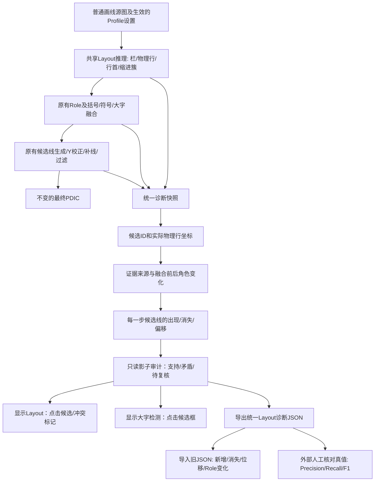

# 普通画线深度优化：统一证据账本、Layout 展示和诊断 JSON（2026-10-12）

适用：Draft PR #459；在验证集未完成前，**新证据决策器仅影子运行，不直接改 PDIC**。
原有普通画线已有图文流程见
[ordinary_draw_click_to_pdic_pipeline_20261012.md](ordinary_draw_click_to_pdic_pipeline_20261012.md)。

## 目标与之前失败的教训

此前第9页多轮修改发现：角色判定来自缩进簇，大字/括号补充视觉证据，
后续若干过滤器又独立增删最终线；只展示 Layout 的红蓝色条或大字框
无法审计这一连串决策。特别是盲目把稳定缩进赋予最高优先级曾造成大量正文误线。

此版采取**证据优先、输出保守**的两轨设计：

- 生产轨：保持用户已验证版本的普通画线和全部既有阈值；保留前期两条
  括号后续行误线的已提交保守修复。不根据新影子分数增删词条。
- 诊断轨：使用同一份物理 Layout、视觉大字候选和
  `processing.detect_entries` 各阶段实际候选坐标；
  建立候选级证据账本和角色冲突标记。Layout 屏幕与导出 JSON 读取**同一个快照**。

## 新增结构流程图



**注意：**图中的 `K/L/M` 源自同一个
`large_head_visualization_ui.get_large_head_debug_snapshot()` 缓存，
`M` 不独立重新创建另一份证据分配结果。
屏幕中角色红/蓝色条也改为优先取这一 JSON 内的
`layout_snapshot.physical_rows`，而不是另一份可能过期的角色缓存。
因此这套诊断是“同一个数据，不同呈现”，而不是多个互相猜测的分析器。

## 实际界面使用

在左侧「显示设置」：
1. **显示Layout**：原有栏边界、起始位置、缩进带及红蓝角色条保持；
   新增每个可审计词头旁的小色块、冲突候选的橙色感叹号。
   点击候选色块可查看实际第一墨迹X、行首证据、角色变更、
   大字检测匹配、进入/退出哪些处理阶段以及最终有无自动线。
2. **显示大字头检测**：绿色/黄色/红色/灰色候选框及蓝色附近自动线，
   仍用正式大字检测器收集的候选。点击查看父框/子框、尺寸、拒绝理由。
3. **导出统一Layout诊断 JSON**：无须打开大字图层即可导出一份报告，
   同时包含物理行、视觉证据、全部处理阶段和最终线。
4. **对比旧诊断 JSON**：选择上一次 Page009 之类的导出，立即显示
   新增/消失/移动的线、角色变更及大字接受数差异；支持历史 v1 JSON。
   只比较同一源图尺寸的坐标，不把变化默认解释为改善。
   
按钮打开的设置是临时显示状态，不写入 `AppSettings` 或 PDIC。

## 统一数据架构

```text
picture-capture-ordinary-evidence-v2
  schema, image_size, page_index, effective_settings
  layout_snapshot:
    body_top/body_bottom, ordinary_line_height, columns,
    physical_rows[]:
      id=C01-R001, column, canonical_y0/1,
      source_x/y, source_x1/y1,
      first_x, corrected_first_x,
      role, entry_source
  candidates[]:
    大字检测原始形态候选、accepted/rejected/split_parent、
    原始父框坐标、拆分数和是否被检测器返回
  layout_role_transitions[], layout_role_stage_counts[]
  ordinary_pipeline_stages[]:
    各次处理后的实际候选线，新增/删除坐标、来源和阶段统计
  final_lines[]: 最终普通画线，而非人工修正PDIC
  unified_report:
    schema, matching_policy, stage_definitions
    registry[]:
      id, physical_row, source_anchor, indent_measurement
      evidence[], detector_matches[], stage_trace[]
      role_transitions[], final_entries[]
      issues[], shadow_assessment, has_final_line
    review_queue[], summary, policy
```

### 证据名称与含义

| 证据类型 | 源头 | 意义 |
|---|---|---|
| layout_entry/layout_body | 最终物理Layout role | 当前已有角色判断；不是人工真值 |
| physical_entry_indent/physical_body_indent | 该栏重复缩进簇与单行真实first-X | **独立诊断证据**；不直接覆盖Layout role |
| verified_bracket | 各阶段候选线的 `ordinary_bracket_pair` 来源 | 当前阶段存在明确括号视觉依据 |
| verified_large_head | 正式大字检测器接受且实际输出的字形 | 独立强词头形态证据 |
| large_head_marker | 大字来源标志或尺寸属性 | 中等证据，不能代替完整视觉字形 |
| post_bracket_continuation | 相邻已确认括号词头+正文缩进带 | 高优先级**待复核提示**，不自动删除 |

### 冲突代码

- `layout_entry_without_final_line`：Layout 认为 entry，却没有最终线；
- `final_line_without_matched_physical_row`：最终线未能对应物理行；
- `final_line_on_body_without_strong_visual_proof`：在 body 行出现了不带强视觉证据的线；
- `accepted_large_head_without_final_line`：大字证实，但缺少邻近最终线；
- `final_line_contradicts_body_indent`：最终线所在真实行首与正文缩进带冲突；
- `possible_post_bracket_body_continuation`：疑似括号词头之后的正文续行。

上述是**错误排查候选**，不是已证实的假阳性或假阴性。
例如，一个 Layout entry 最终不画线，可能是正确删除了跨行大字内部的重复线。

### 溯源的空间匹配限制

候选ID（如 `C01-R017`）在**同一次运行的一页内稳定**，
不是跨算法版本持久身份。同一次页面中可通过 ID 对照
物理行、词头证据和处理阶段。跨版本时用原图坐标和可调容差进行
一对一匹配，不能仅比较行序号。

关联采用源图 X/Y 容差（正文行高的约0.85倍，最多27px），
JSON 的 `matching_policy` 会明确披露这一点。
匹配只说明“靠近”，**不保证独立检测器在因果上生成了该线**。
对于大字跨行和相邻行密集的异常页，必须结合阶段变更记录判断。

## 影子决策器与安全门槛

`ordinary_unified_diagnostics.compose_ordinary_evidence_report`
在不改变正常检测器的情况下，生成只读 `shadow_assessment`：

- `supported_headword`：存在括号/大字等独立强视觉词头证据；
- `baseline_headword`：Layout entry 与最终线一致；
- `body`：正文角色且暂未观察到输出冲突；
- `review_conflict`：角色、缩进、视觉证据与最终线矛盾；
- `uncertain`：证据不足。

**绝不能因为这个标签就新增/删除 PDIC 线。**
`policy.production_output_changed=false` 与
`shadow_assessment.would_change_output=false` 均是固定契约。
下一阶段若要让它成为可执行裁决，需在用户认可的真实标注集上
针对误画/漏画给出逐页对照结果，再明确启用阈值与回退开关。

## 新旧JSON对比

`ordinary_unified_diff.compare_ordinary_diagnostics(old, new)`
不依赖 OCR 文本，可用于早期大字 JSON v1 和统一 JSON v2。
报告包含按 X/Y 坐标一对一匹配的保留、新增、消失、位移线，
及同一栏物理行的角色变化。图片尺寸不同会直接拒绝比较。
没有人工标注不能声称新版本 Precision/F1 已改善。

## 严格评价入口

`tools/evaluate_ordinary_verified_lines.py` 仅接受如下**明确人工复核**数据：

```json
{
  "schema": "picture-capture-human-reviewed-lines-v1",
  "human_verified": true,
  "image_size": [1388, 2156],
  "lines": [
    {"x": 0, "y": 100},
    {"x": 0, "y": 200}
  ]
}
```

以上坐标仅为**格式示例**，不是第9页实际真值。

```powershell
python tools/evaluate_ordinary_verified_lines.py .\Page009_latest.json .\Page009_reviewed.json --tolerance 12 --output .\Page009_metrics.json
```

明确拒绝把未经修改的自动 PDIC、`*.auto-baseline.json`
或普通训练导出的 `ground_truth_lines` 当成真实人工标注；
只有明确 `human_verified=true` 的复核文件可计算 TP/FP/FN/Precision/Recall/F1。

## 质量与退化的正式验收标准

**阶段A（此PR）**：导出内容/GUI值一致；打开诊断对普通画线无副作用；
具备真实各阶段溯源；三平台 pytest+GUI 启动通过。

**阶段B（需要用户实际运行导出）**：对第9页及其他9页同一批
扫描进行不改参数的重新画线。自动线坐标和来源先作回归对比；
人工确认的标签单独计分。检查候选关联是否准确、缓存开关是否
产生滞后、GUI 位置是否与 JSON 源图坐标一致。

**阶段C（未来新决策模型）**：以人审真值衡量宏平均/微平均 Precision、
Recall、F1，分「有【】/无【】」「大字/普通字」「插图干扰」
「左右栏」「页面边界」分别报告 TP/FP/FN。
必须对退化页做阻断，尤其不能以第9页的改善掩盖另外9页的退化。

## 性能与已知限制

首次打开统一 Layout 诊断时需要一次较重的图像证据审计和只读最终画线
计算；同页未改图像/设置时使用会话级缓存。切换页、设置、去噪方式
会使缓存 key 变化。关闭诊断时，原普通画线路径不增加证据账本分配。
本PR**没有**宣称已完成完整10页的人审验收，亦未用自动线数量代替准确率。

如果报告生成异常，Layout 仍保留旧显示兜底；错误类型在界面显示，
不应使普通画线或项目编辑失败。

## GUI 可发现性与诊断交互修正（2026-10-12，后续验收）

用户反馈「显示Layout」与旧版看起来没有区别。源码核查确定上一版
`ordinary_unified_visualization.py` 将候选标记放在
`(source_x-22)*view_scale`、绘制宽度仅 `6–9*view_scale` 像素。
第一页栏首 x=0～20px 时，标记在图像左边界之外或变成不可点的
不足2px小块。旧实现虽然写入统一JSON，却没有给实际紧凑设置页
提供醒目的候选查看入口。

修正方案：

- 「显示Layout」使用**16px普通词头/20px冲突候选的固定屏幕大小**
  的绿色实心/橙色空心标记，不再随扫描缩放缩小为亚像素；标记
  X 坐标不小于26屏幕像素，防止栏首词头的色块画到视野之外；
- 点击标记进入独立「Layout候选与最终画线审计」窗口并自动选择
  该候选；事件返回 `break`，防止点击诊断标记同时操作页面编辑；
- 左侧实际**紧凑显示设置**增加「查看Layout候选/异常」按钮；
  非紧凑设置页也加相同入口，避免用户无法发现已实现的功能；
- 审计窗口以**统一导出JSON的同一份缓存候选**为源，
  显示物理行、候选数、最终线数、待复核数，并提供五种筛选：
  待复核、全部、最终线、Layout词头、大字候选；
- 列表查看 `候选ID/栏/Y/角色/最终线/证据/中文复核原因`，
  选中显示完整的行首X、纠正X、角色来源、证据强度、
  所有阶段来源、角色变更及最终线坐标；双击或点击「定位选中候选」
  将主图滚动至源图Y，并画固定屏幕尺寸的橙色虚框以准确定位；
- 诊断窗口的「导出同一份JSON」调用原导出入口；没有新算法、
  预测坐标、自动线或参数副本，不触碰PDIC或AppSettings。

新增真实 `tkinter.Toplevel + ttk.Treeview` 的GUI验证
（有显示环境时执行），以及缩放0.27倍、栏首X=3时至少16px可见、
候选点击精确定位、紧凑面板按钮存在的回归测试。

**验收观察点**：升级并完全重启PR #459后，在「显示设置」里应能
直接看到「查看Layout候选/异常」按钮；点击后出现表格且首选待复核项
（没有冲突时默认全部候选）。若仍未出现，应先核对本地启动目录/
更新分支和提交号，而不是假设仅仅是检测器漏检。

## Layout 叠加图层简洁化（用户第4页截图反馈）

原叠加将横跨上百行的 `method`、原始/使用参数和所有缩进记录
绘制在第一栏中间，遮挡词典正文；同时顶部叠加栏目标签和统一
候选统计文字、行首黄色缩进色块和大量绿色候选方块。用户报告
“排布太乱”，确属 UI 可读性问题，并非需要改变检测器阈值。

现在**实际「显示设置」**中新增 `Layout叠加` 显示密度：

| 模式 | 扫描图上显示 | 点击行为 |
|---|---|---|
| 简洁（默认） | 栏边界、body 范围、细红蓝角色条、**仅橙色待复核标记** | 点击橙色 `!` 跳转诊断表并选中对应候选 |
| 候选 | 同上，额外显示所有确认候选的绿色方块；但仍无大段文字 | 点击绿色词头方块或橙色标记跳转相同诊断窗口 |
| 详细 | 原来的完整方法/参数/黄缩进色块等重度覆盖层 | 保留研究版详细检视 |

**注意：**绿色方块代表统一候选证据中的词头标记，不是原图印刷字形
的整个可点击矩形。点击词头旁的**绿色小标记**可以打开诊断表
并选择该候选；点击黑色汉字正文区域不是触发此诊断动作。
`简洁` 模式为了不遮挡页面，**仅显示橙色问题标记**，
如需点击正常词头，先将 `Layout叠加` 设为 `候选`。

长篇参数报告和完整证据仍可在「查看Layout候选/异常」窗口及
「导出统一Layout诊断 JSON」中访问；**简洁化不删除信息，
只更改显示密度**。颜色角色条和橙色复核标记使用同一
`unified_report`，但诊断仍为只读，不影响普通画线 PDIC。

回归测试覆盖：默认最小显示不会画任何正文遮挡文本或大块背景；
精简渲染不调用黄色缩进块绘制；一页100个候选、仅3个冲突时
默认只有3个可点击橙色标记；切换 `候选` 有100个标记且可点；
`详细` 保留旧渲染分支；普通画线/Settings 不修改。
